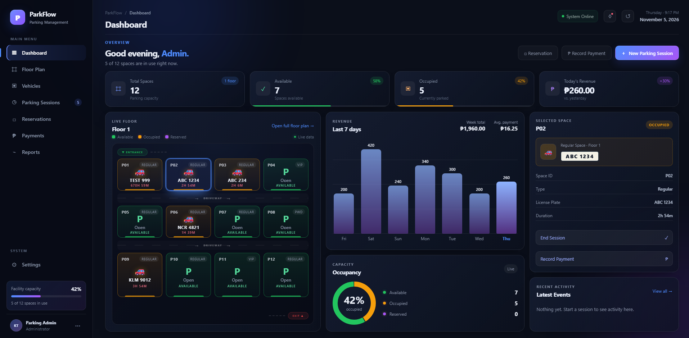

# 🅿️ ParkFlow — Parking Management System

A modern, full-stack parking management platform designed to handle real-world facility operations. Features a live interactive floor plan, session lifecycle tracking, reservations, and real-time analytics.

> **Live Demo:** *Coming Soon*



## ✨ Features
- **Live Floor Plan:** Interactive grid showing Available, Occupied, and Reserved slots.
- **Session Lifecycle:** Start and end parking sessions with automatic DB updates.
- **Reservations:** Create bookings and convert them to active sessions.
- **Payments & Analytics:** Record payments and view revenue trends in interactive charts.
- **One-Screen Dashboard:** A true enterprise-style layout with 3 columns (Map, Analytics, Activity).

## 🛠️ Tech Stack
- **Frontend:** React (Vite), React Router, Context API, Vanilla CSS (Glassmorphism design).
- **Backend:** Node.js, Express.
- **Database:** PostgreSQL (Relational schema for spaces, sessions, reservations, payments).

## 🚀 Running Locally

**1. Clone the repository**
```bash
git clone https://github.com/keifdev/ParkFlow.git
cd ParkFlow
